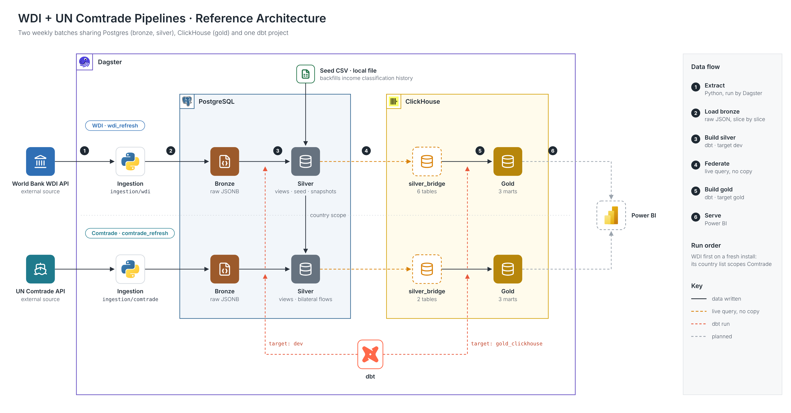

# African Economic & Trade Analytics Pipeline

An end-to-end data engineering pipeline for 54 African countries, with two sources:

- **WDI**: economic indicators from the World Bank's World Development Indicators API, historized over time.
- **UN Comtrade**: annual trade between each country and its partners, from the UN Comtrade API.

Each source is its own pipeline, with its own Dagster job and schedule.

The architecture uses PostgreSQL for the raw, staging and core layers and ClickHouse for the marts. Instead of duplicating Postgres data into ClickHouse, the marts query staging and core through a live cross-database bridge, keeping the analytical layer current without an additional data-copy step.

## Tech stack

- **Ingestion**: Python
- **Transformation**: dbt-core (`dbt-postgres` for staging and core, `dbt-clickhouse` for the marts)
- **Warehouses**: Postgres (raw, staging, core) and ClickHouse (marts), in Docker
- **Orchestration**: Dagster
- **BI**: Power BI

## Architecture



## Documentation

Column-level docs, lineage graph, and test coverage:
**[ppius6.github.io/africa-economic-data](https://ppius6.github.io/africa-economic-data/)**

Every mart carries an enforced dbt contract, so a schema change that doesn't match the declared column types fails the build.

## Data scope

- 54 African sovereign states, as a fixed ISO3 list.
- **WDI**: 26 indicators covering growth, trade, demographics, labor, prices, health, education, infrastructure, and agriculture. Observations run from 1990 to the latest year WDI has published, with income classification history starting in 1987.
- **Comtrade**: total goods trade (HS `TOTAL`) by partner, yearly from 1990. Recent years fill in as countries report, which can take two years or more.

## Marts

| Mart | Grain | Pipeline |
|---|---|---|
| `dim_country` | Country × income-classification period (SCD2) | WDI |
| `dim_indicator` | Indicator | WDI |
| `fct_economic_indicator` | Country × indicator × year | WDI |
| `dim_trade_area` | Comtrade area (M49 code): countries, World, customs unions, other areas | Comtrade |
| `bridge_area_country` | Area × member country | Comtrade |
| `fct_bilateral_trade` | Year × exporter × importer | Comtrade |

## Key design decisions

- **Raw is untouched.** API responses land as JSONB in the `raw` schema. Each load replaces the previous copy, so history is kept in `core`, not here.
- **Ingestion is idempotent.** Each run deletes and reinserts per indicator, so re-runs never leave duplicate or stale rows.
- **History is kept.**
  - `dim_country` is an SCD2 dimension. A seed backfills the World Bank's income-classification history (1987 onward), and a dbt snapshot tracks changes from its first run. `dim_country` unions the two.
  - Indicator values are snapshotted too, so when the World Bank revises a figure, the old and new values both stay on record. The fact table reads only the current row.
- **The marts read Postgres through a live bridge.** ClickHouse's `PostgreSQL` table engine exposes staging and core as `pg_bridge.*`, and the mart models read it via `source()`, since dbt can't `ref()` across adapters. No data is copied.

### Comtrade

- **Both ends of each flow are kept.** A country's exports to a partner and the partner's imports from it are reported separately, and they rarely agree. `fct_bilateral_trade` stores both as `exporter_reported_usd` and `importer_reported_usd`. Imports are usually valued including freight and insurance (CIF), exports at the border (FOB).
- **Countries that don't report are still covered.** Each year is pulled twice: the 54 countries' own reports, and every country's reports about them. Partners' figures cover countries that don't report, such as Libya or Somalia.
- **Countries are matched on M49 codes, which change over time.** Ethiopia (230, later 231) and Sudan (736, later 729) each have two codes, and the Southern African Customs Union (711) reported for South Africa, Botswana, Lesotho, Namibia and Eswatini until 1999.
- **Summing through `bridge_area_country` double-counts.** It maps the customs union to all five members, so a sum joined through it counts the union's trade once per member. Use it to filter or label, not to total.
- **Scheduled runs refresh only recent years.** A run without arguments re-pulls the last five complete years, about 12 API calls. Each run replaces one year at a time, and keeps the existing rows if the API returns much less than before. For a full refresh, run it by hand with a year range (see below).

## Running locally

1. Copy the environment file, add a free UN Comtrade API key as `COMTRADE_API_KEY` (from [comtradedeveloper.un.org](https://comtradedeveloper.un.org)), and start everything:

   ```bash
   cp .env.example .env
   docker compose up -d
   ```

   The first run builds the image and takes a few minutes.

2. Open the Dagster UI at <http://localhost:3100>. To use another port, set `DAGSTER_PORT` in `.env`.

3. Go to Overview → Jobs and launch a run of each pipeline:
   - `wdi_refresh` builds WDI raw, staging and core, then the marts.
   - `comtrade_refresh` does the same for Comtrade. Run `wdi_refresh` first, since Comtrade reads the country list from WDI's staging layer.

To stop: 

- `docker compose down` 

Or delete everything:
- `docker compose down -v` deletes it.

After changing anything, run `docker compose up -d --build`.

### Optional

- **Single asset:** Overview → Assets, select it, click Materialize selected. Use the graph view to see the full dependency chain.
- **Schedules:** `wdi_refresh_schedule` and `comtrade_refresh_schedule` both run Mondays at 6am (Nairobi time) and start paused. Turn them on under Overview → Schedules after a manual run of each succeeds.
- **Full Comtrade refresh:** `cd ingestion && uv run python -m comtrade.pipeline 1990 2025` re-pulls every year (74 API calls; the free key allows 500 a day).
- **Tests:** `uv run pytest` from the project root.
- **Without Dagster:** with the databases running and `uv sync` done, run these in order:

  ```bash
  cd ingestion && uv run python -m wdi.pipeline && uv run python -m comtrade.pipeline
  cd ../dbt_project
  uv run dbt build --target dev --select tag:postgres
  uv run dbt build --target clickhouse --select tag:clickhouse
  ```

## Future directions

- **Trade by product** (HS chapters) instead of totals only.
- **Africa Visa Openness Index**, which needs semi-manual extraction from PDF reports.
- **African transport network** (roads, air routes), modeled as an edge-list fact table.
